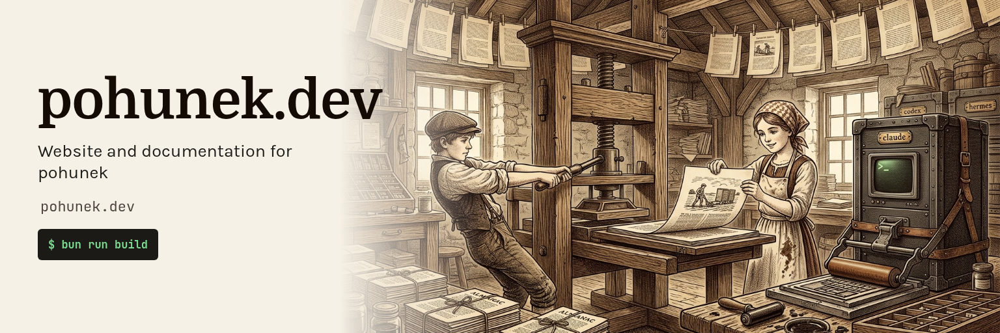

<p align="center">
  
</p>

# pohunek.dev

Website and documentation for [pohunek](https://github.com/zajca/pohunek), the
headless multihost backbone for coding agents. Served at https://pohunek.dev
from GitHub Pages.

## Layout

| Path | Content |
|---|---|
| `src/pages/` | Landing, why, surfaces, plugins, roadmap, changelog, install |
| `src/content/docs/docs/` | Generated documentation (gitignored, see below) |
| `src/data/` | Page data: landing copy, surfaces, roadmap, page banners |
| `src/data/changelog/` | Recorded changelog of every product release (written by `scripts/follow-releases.ts`) |
| `src/config/agents.mjs` | `llms.txt`, `robots.txt` and `/.well-known/security.txt` settings |
| `src/styles/` | Design tokens and styles, see [DESIGN.md](DESIGN.md) |
| `scripts/sync-docs.ts` | Pulls pohunek's docs at the pinned release |
| `scripts/sync-screenshots.ts` | Pulls the Android screenshot set at the pinned release |
| `scripts/follow-releases.ts` | Moves the pins to new releases and records their changelog |
| `releases.config.json` | Every ecosystem product: repository, tag prefix, pinned version, install assets |
| `.github/assets/` | README hero of this repository |

The documentation is never edited here. `scripts/sync-docs.ts` takes a
whitelisted set of files from `zajca/pohunek` at the tag of the `pohunek`
product in `releases.config.json`, rewrites their links and writes them into the Starlight
content collection. Fix docs upstream, then bump the tag.

Agents get the same docs as plain text: `starlight-llms-txt` renders
`/llms.txt`, `/llms-full.txt`, `/llms-small.txt` and the sets under
`/_llms-txt/`, and `/install-prompt.txt` serves the README install prompt.
`/.well-known/security.txt` gets a fresh `Expires` on every build, so the site
needs a deploy at least every 180 days.

## Releases and changelog

`releases.config.json` pins one release of every product the site names:
pohunek, the desktop and Android companions, and the pohunek-work plugin,
launchers and web surfaces. The header badge, the docs, the Android
screenshots, the surface pages and the install commands all read their versions
from it; no version is written anywhere else.

`.github/workflows/follow-release.yml` moves the pins on its own every three
hours. `scripts/follow-releases.ts` finds each product's newest release (a
pre-release only for a product that follows them), downloads every install
asset the config names, checks it against its `.sha256` file and GitHub's
digest and, for an attested product, runs `gh attestation verify`. Only then
does it move the pin. It also records the changelog of every release up to
the pin in `src/data/changelog/<product>.json`: the block between
`<!-- pohunek-changelog:start -->` and `<!-- pohunek-changelog:end -->` of the
release body (the ecosystem changelog contract,
[zajca/pohunek#1588](https://github.com/zajca/pohunek/issues/1588)), or, for a
release without one, the titles of the pull requests merged since the previous
release, marked as generated. The workflow then tests and builds the site,
pushes the data to `main` and starts a deploy; a failed check leaves every pin
where it was. Run it by hand from the Actions tab to follow a release at once,
or with a product and a version to pin a newer release.

Locally (needs `gh` signed in):

```bash
GH_TOKEN="$(gh auth token)" bun run follow-releases                      # every product
GH_TOKEN="$(gh auth token)" bun run follow-releases --product web --version 0.3.2
```

`/changelog/` lists every release newest first, `/changelog/<product>/` one
product, `/changelog.xml` is an Atom feed of the newest releases and
`/changelog.txt` the whole changelog as Markdown for agents. Release bodies
come from other repositories: raw HTML is dropped, links keep only http(s)
targets and images become links.

## Android screenshots

The Android gallery on `/surfaces/android/` is never edited here either. The
Android repository commits the canonical set as `docs/screenshots/*.png` with a
`manifest.json` (schema 1: captions, alt text, sizes and SHA-256 digests), and
every release tag contains it. `scripts/sync-screenshots.ts` reads the manifest
at the tag of the `android` product in `releases.config.json`, checks each image against its digest and
size, writes the images to `src/assets/screenshots/android/` and the module
`src/data/generated/android-screenshots.ts` (both gitignored). It fails, naming
the ref, when the manifest is missing, has another schema, lists a missing
file, or an image differs from the manifest; it never renders an empty gallery.

The Android pin follows new releases like every other product (see above). The
pin on `main` is always a release tag, never a branch or a commit.

To try a checkout or a branch before it is tagged:

```bash
bun scripts/sync-screenshots.ts --source ../pohunek-companion-android --ref main
```

## Develop

```bash
bun install
bun run dev        # syncs docs and screenshots, then starts the dev server
bun test           # tests for the docs and screenshot sync, the release pins and the changelog
bun run build      # syncs docs and screenshots, then builds dist/
```

## Deploy

`.github/workflows/deploy.yml` builds every push and pull request. The deploy
job runs on `main` only when the repository variable `PAGES_ENABLED` is
`true`, which is set once GitHub Pages (source: GitHub Actions) and the custom
domain are configured.
