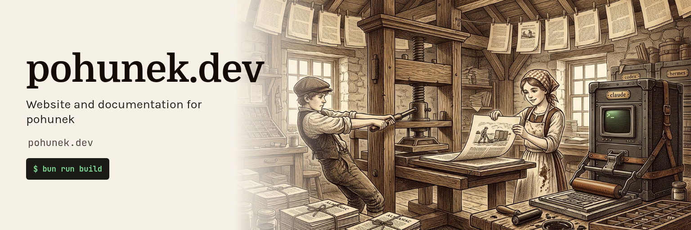

<p align="center">
  
</p>

# pohunek.dev

Website and documentation for [pohunek](https://github.com/zajca/pohunek), the
headless multihost backbone for coding agents. Served at https://pohunek.dev
from GitHub Pages.

## Layout

| Path | Content |
|---|---|
| `src/pages/` | Landing, why, surfaces, plugins, built on pohunek (`/built-on/`), roadmap, changelog, install, the Šafář review product page (`/autoreview/`) |
| `src/content/docs/<routePrefix>/` | Generated documentation, one directory per product (gitignored, see below) |
| `src/data/` | Page data: landing copy, surfaces, products built on pohunek (`built-on.ts`, one entry per product), roadmap, page banners |
| `scripts/generate-surface-og.ts` | Renders one 1200x630 link preview PNG per surface page into `public/og/` from the surface data and the site fonts |
| `src/data/changelog/` | Recorded changelog of every product release (written by `scripts/follow-releases.ts`) |
| `src/config/agents.mjs` | `llms.txt`, `robots.txt` and `/.well-known/security.txt` settings |
| `src/styles/` | Design tokens and styles, see [DESIGN.md](DESIGN.md) |
| `scripts/sync-docs.ts` | Pulls each product's docs at its pinned release |
| `scripts/sync-screenshots.ts` | Pulls the Android screenshot set at the pinned release |
| `scripts/sync-media.ts` | Pulls the Android demo video at the pinned release into `public/media/android/`; a release without `docs/media/manifest.json` renders no video |
| `scripts/follow-releases.ts` | Moves the pins to new releases and records their changelog |
| `scripts/revert-products.ts` | Puts the products whose docs sync failed back on their base-commit pin and changelog (dependency-free) |
| `releases.config.json` | Every ecosystem product: repository, tag prefix, pinned version, install assets |
| `.github/assets/` | README hero of this repository |

The documentation is never edited here. `docs-sync.config.json` lists one
source per product: `scripts/sync-docs.ts` takes its whitelisted files from the
product's repository at the tag pinned in `releases.config.json`, rewrites
their links and writes them into the Starlight content collection under the
source's `routePrefix` (`/docs/` for pohunek, `/autoreview/` for autoreview).
Each prefix is one path segment of its own, so syncing one product never
touches another's pages, and each docs page shows only its own product's
sidebar (`src/config/sidebar.mjs`, filtered by `src/route-middleware.ts`). The
autoreview sidebar follows the synced pages, so a release that adds or removes
a page deploys without a sidebar edit; the build log warns about each such page,
and its sidebar line belongs in `src/config/sidebar.mjs` afterwards. A link to a
repository file that is not a page becomes a GitHub link at the tag; a link
into another product's docs is written upstream as an absolute
`https://pohunek.dev/...` URL. Fix docs upstream, then bump the tag.

To preview one product's docs from a checkout or a branch before it is tagged:

```bash
bun scripts/sync-docs.ts --product pohunek --source ../pohunek --ref main
```

Agents get the same docs as plain text: `starlight-llms-txt` renders
`/llms.txt`, `/llms-full.txt`, `/llms-small.txt` and the sets under
`/_llms-txt/`. `/install-prompt.txt` serves the install prompt of the pohunek
README and `/autoreview/install-prompt.txt` that of the autoreview README.
`/.well-known/security.txt` gets a fresh `Expires` on every build, so the site
needs a deploy at least every 180 days.

## Releases and changelog

`releases.config.json` pins one release of every product the site names:
pohunek, the desktop and Android companions, the Omarchy bar widget, the
pohunek-work plugin, launchers and web surfaces, and Šafář review (`pohunekd/autoreview`). The header badge, the docs, the Android
screenshots, the surface pages and the install commands all read their versions
from it; no version is written anywhere else.

`.github/workflows/follow-release.yml` moves the pins on its own every three
hours. `scripts/follow-releases.ts` follows every product on its own: it finds
each product's newest release (a pre-release only for a product that follows
them), downloads every install asset the config names, checks it against its
`.sha256` file and GitHub's digest and, for an attested product, runs
`gh attestation verify`. Only then does it move the pin. The script also
records the changelog of every release up to the pin in
`src/data/changelog/<product>.json`: the block between
`<!-- pohunek-changelog:start -->` and `<!-- pohunek-changelog:end -->` of the
release body (the ecosystem changelog contract,
[zajca/pohunek#1588](https://github.com/zajca/pohunek/issues/1588)), or, for a
release without one, the titles of the pull requests merged since the previous
release, marked as generated. A product whose assets or attestation fail
keeps its old pin (and its old changelog entries) while every product that
passed still moves; the `collect` job's step outputs name the failed products
with their reasons, and the run fails at the end through its `report` job.

The `verify` job then syncs every product's docs on its own:
`scripts/sync-docs.ts`, `scripts/sync-screenshots.ts` and
`scripts/sync-media.ts` run with `--keep-going`, so one product's broken docs
are recorded in `failed-sync.json` and the other products still sync.
`scripts/revert-products.ts` puts each failed product back on its base-commit
pin and changelog, and the job tests and builds that tree. The build syncs
every product again at those pins without `--keep-going`, so a failure there
fails the job; that includes a product that did not move but fails at its base pin, so no product ships in that run. Third-party code (`bun install`, the syncs, astro) runs only in
`verify`, and `verify` uploads no file: it passes on only the ids of the
products whose sync failed. The `finalize` job (read-only token) takes `collect`'s dependency-free
artifact, validates that id list strictly (known product ids only, bounded
size), puts those products back on their base state with the same
`scripts/revert-products.ts`, writes the commit message with
`scripts/commit-summary.ts` and uploads the result. The `publish` job, the only
one with `contents: write`, runs no bun and no third-party action except checkout
and download-artifact: it takes that artifact through
`scripts/take-release-data` (expected files only, commit message validated),
commits it, and only its final push step holds the token. The deploy builds from
the committed tree, where a failed product is on its base pin again. A product
whose docs failed ships its old pin; the products that passed ship their new
pins. When nothing is left to commit, no deploy starts. Run the follow by hand
from the Actions tab to follow a release at once, or with a product and a
version to pin a newer release.

A failing product is reported, not retried: the `report` job writes one table
row per product (`moved` or `FAILED` with the reason from either job) to the
run summary and fails the run, after the products that passed went through.
The `collect` and `verify` logs name the same reasons. A step that crashes
(any failure other than "some product failed") fails its job and the run.

Locally (needs `gh` signed in):

```bash
GH_TOKEN="$(gh auth token)" bun run follow-releases                      # every product
GH_TOKEN="$(gh auth token)" bun run follow-releases --product web --version 0.3.2
```

`/changelog/` lists every release newest first, `/changelog/<product>/` one
product, `/changelog.xml` is an Atom feed of the newest releases and
`/changelog.txt` the whole changelog as Markdown for agents. Release bodies
come from other repositories: raw HTML is dropped, links keep only http(s)
targets and images become links.

## Android screenshots

The Android gallery on `/surfaces/android/` is never edited here either. The
Android repository commits the canonical set as `docs/screenshots/*.png` with a
`manifest.json` (schema 1: captions, alt text, sizes and SHA-256 digests), and
every release tag contains it. `scripts/sync-screenshots.ts` reads the manifest
at the tag of the `android` product in `releases.config.json`, checks each image against its digest and
size, writes the images to `src/assets/screenshots/android/` and the module
`src/data/generated/android-screenshots.ts` (both gitignored). It fails, naming
the ref, when the manifest is missing, has another schema, lists a missing
file, or an image differs from the manifest; it never renders an empty gallery.

The Android pin follows new releases like every other product (see above). The
pin on `main` is always a release tag, never a branch or a commit.

To try a checkout or a branch before it is tagged:

```bash
bun scripts/sync-screenshots.ts --source ../pohunek-companion-android --ref main
```

## Link preview images

Each surface page (`/surfaces/<slug>/`) has its own `og:image`, rendered from
that surface's hero banner art and the site fonts. The card texts mirror the
page data, so no preview text lives anywhere else:

- title = `surface.name`, kicker = `surface.platform` uppercased, lead =
  `surface.summary` (all in `src/data/surfaces.ts`, which also carries the
  `ogImage` path that `src/pages/surfaces/[slug].astro` passes to
  `MarketingLayout`, emitted as both `og:image` and `twitter:image`)
- caption and art = the banner entry in `src/data/banners.ts`
  (`src/assets/brand/banner-<slug>.png`)

After changing a surface name, summary, platform, banner caption or banner
art, re-render and commit the result:

```bash
bun scripts/generate-surface-og.ts
```

The generator draws every text as glyph outlines from the real
`@fontsource` woff files (via `fontkitten` in `scripts/lib/og-draw.ts`), so
the PNGs use the site fonts whatever the host has installed; the SVG it
renders contains no `<text>`. Colours come from `src/styles/tokens.css`.
It wraps the lead and the caption to fit the card and fails (exit 1) when a
line would overflow the column or the lowest caption ink (last baseline plus
the caption font's descender) would leave no room for the separator rule
above the URL; keep the sizes (kicker 22, title 84, lead 34, caption 24, URL
26 px at 1200x630, nothing smaller than 22 px) so the card stays readable at
the ~500 px width link previews render at.

## Develop

```bash
bun install
bun run dev        # syncs docs and screenshots, then starts the dev server
bun test           # tests for the docs and screenshot sync, the release pins and the changelog
bun run build      # syncs docs and screenshots, then builds dist/ (no --keep-going: a broken sync fails the build)
```

## Deploy

`.github/workflows/deploy.yml` builds every push and pull request. The deploy
job runs on `main` only when the repository variable `PAGES_ENABLED` is
`true`, which is set once GitHub Pages (source: GitHub Actions) and the custom
domain are configured.
